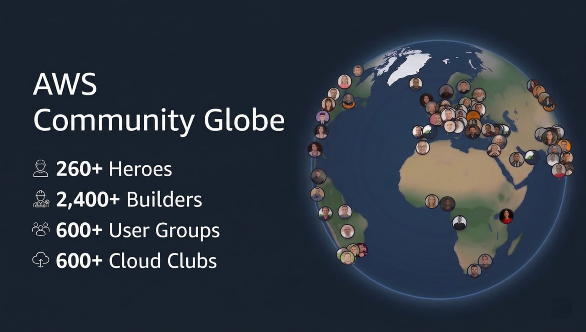

# AWS Globe

An interactive world for discovering the people, groups, events, workshops, and stories that make up the global AWS community.

[Open the live globe](https://awscommunityglobe.click/) · [Report an issue](https://github.com/Jagatees/aws-community-world/issues)



## About the project

AWS information lives across community directories, event pages, and publishing platforms. AWS Globe brings those sources into one visual experience so people can discover members nearby, explore events worldwide, find hands-on workshops, and read the latest Builder Center news.

The project is built in public and is not an official AWS product.

## Explore

### Homepage previews

Click or tap the section name in the homepage heading to cycle through **Community Globe → Event Globe → Workshops Globe → Scrapbook Globe → Insights Globe → Experimental Globe**. The heading button also works with Enter and Space. Each choice updates the introduction, preview, and action button; use that action button to enter the selected section.

Community and Events show globe previews. Workshops shows a service workbench, Scrapbook an open book, Insights charts and community counts, and Experimental a collection of experiment icons. These previews adapt to mobile layouts and respect reduced-motion preferences. After entering a section, the main content menu lets you switch between all six experiences.

### Community

The community tabs use this order on desktop and mobile:

- **Heroes** — browse AWS Heroes by specialization and location.
- **Community Builders** — explore Builders worldwide, including country-level summaries and public Builder profiles.
- **User Groups** — find local AWS User Groups represented by country flags.
- **Student Builder Groups** — discover university and student-led AWS communities and their leaders.
- **Kiro Ambassadors** — an early view of the growing Kiro community.
- **Golden Jackets** — discover publicly documented recipients, with gold markers, recognition sources, and clearly labeled alumni. This is a growing directory, with all profiles available in Directory and Gallery.
- **Ambassadors** — explore the AWS partner community, with portraits, roles, partner links, and country filters. Profiles without confirmed countries remain searchable in Directory and Gallery.

### Events and news

- **Builder Center Events** — explore published AWS community events with search, status, format, country, city, topic, and date sorting. Physical events appear on the globe; online events stay in the directory. Event details preserve the published time zone and link to the official registration instructions.
- **Kiro Events** — discover Kiro events with the same compact date toolbar, expandable search and sorting, and directory/calendar shortcuts as Builder Center Events. Kiro topics appear as quick pills, and registration links still open the original event pages.
- **Builder Lofts** — explore AWS builder spaces in San Francisco, Berlin, Hyderabad, and São Paulo, with open/announced status, offerings, access information, and official links.
- **News** — read the latest and trending posts from AWS Builder Center in a map-linked news panel.
- **AWS Community Day Singapore** — a dedicated agenda, venue, map, and session-planning experience at `/community-day-singapore/`.

Community Days published on Builder Center appear under **Builder Center Events**. The separate Community Days navigation tab has been retired. Its existing dataset and saved `/?tab=community-days` links remain available because the Builder Center feed does not cover every entry in that directory.

### Workshops

Browse AWS services and their hands-on workshops, with search and filters for category, level, language, duration, and sandbox availability. Selections are retained in the URL. The optional **3D world** turns the catalog into a walkable district of service shops, with fast travel, keyboard and touch controls, and Kiro guidance to service shops. **Build My Path** offers guided learning paths through the catalog. See the [workshop explorer guide](docs/workshops.md) for controls, sources, and refresh details.

### Scrapbook

Build a personal community scrapbook across ten pages with stickers, photos, notes, and reactions. Changes are saved in the current browser's local storage.

### Insights

Explore historical snapshots of six community and event datasets, including regional coverage and additions or removals between snapshots. These are public-directory records, not attendance or engagement analytics; source discontinuities are labeled in the dashboard.

### Experimental

Try four alternative explorations: **Country Mosaic**, **Hero Orbit**, **Event Reveal**, and **Global Infra**. This section is a playground for new visual experiences.

## View modes

The floating view switcher uses product-facing names instead of renderer names:

| View | Internal renderer | Best for |
| --- | --- | --- |
| **Earth** | `globe.gl` | Photorealistic exploration, overview clusters, and detailed profile markers |
| **Minimal** | `cobe` | A lightweight, low-detail globe overview |
| **Map** | Mapbox flat map / SVG map | Familiar two-dimensional geographic browsing, with a lightweight SVG map on mobile |
| **Gallery** | Custom React archive | Visually browsing profiles without using a map |
| **Directory** | Custom React list | Scanning and opening records in a conventional list |

The selected view is shown by a fluid sliding control and is stored in the URL, so a specific view can be shared.

Desktop offers Earth, Minimal, Map, Gallery, and Directory. Mobile offers Minimal, Map, Gallery, and Directory. Gallery is available for all seven community categories. Atlas remains the Mapbox globe renderer used by country spotlights; it is not a standard view-switcher option. Dedicated event experiences can provide their own view controls.

## Interaction highlights

- **People, group, and place search** — search the selected category by name, location, specialty, organization, role, or group leader. Search is case-insensitive and works with the active region, country, specialty, and new-arrival filters. Results sharing one mapped location bring that location into focus.
- **Zoom-aware clustering** — nearby locations combine into count markers at overview zoom and separate as the camera moves closer. Detailed clusters retain their member lists, portraits, and complete counts.
- **Lighter dense directories** — Earth reuses cluster calculations and marker elements, limits offscreen rendering, and defers portrait loading. Student Builder Groups starts with a lightweight map summary, then loads full profiles for search, details, new arrivals, Gallery, or Directory. See the [map performance notes](docs/sbg-map-performance.md) for the Mapbox/MapLibre implementation and measured limits.
- **Program-specific fallbacks** — missing photos use the official AWS Community Hero, AWS Community Builder, or Student Builder Group artwork.
- **Smart cluster totals** — Community Builder country summaries retain their complete Builder count while previewing real member portraits.
- **Region, country, and specialty filters** — narrow the globe without losing the current view.
- **Near Me** — use browser geolocation to move the map toward the visitor's location.
- **Profile details** — open people, group leaders, social links, Builder profiles, event pages, and registration links.
- **Searchable cluster popups** — every multi-entry selection includes search across names, locations, specialties, organizations, roles, and group leaders, across all seven community categories. Larger selections use 30-row pages with Previous/Next controls and result counts. Changing the search or selection resets the page.
- **Dismissible new-arrival list** — close the **New this month** sidebar while keeping the globe filtered to new records, then reopen it from the compact control. **Show All** clears the new-arrival filter.
- **Scrollable category tabs** — hover over the category strip and use the mouse wheel to move through overflowing tabs while the region, country, and search controls stay in place. Horizontal trackpad scrolling and browser zoom shortcuts are preserved.
- **Recognition and location sources** — Ambassador and Golden Jacket profiles link to their public sources. Pins use approximate locations, and profiles without confirmed countries stay available in Directory and Gallery.
- **Community suggestions** — use Suggest to prepare a missing profile or event for review on GitHub, including Golden Jacket recipients.
- **Live route state** — tab, filters, view, theme, and special views are reflected in query parameters.
- **Country 3D spotlights** — Student Builder Groups include focused Mapbox-powered Singapore and Sri Lanka experiences.
- **Responsive controls** — touch-friendly zoom, navigation, filtering, and view switching.
- **Graceful fallbacks** — the app can fall back to a flat SVG world map when WebGL is unavailable.

## Current data snapshot

The checked-in data as reviewed on **6 November 2026** contains:

| Dataset | Records |
| --- | ---: |
| AWS Heroes | 255 |
| AWS Community Builders | 3,041 |
| AWS User Groups | 609 |
| AWS Student Builder Groups | 1,626 |
| Kiro Ambassadors | 7 |
| Golden Jackets | 68 |
| Ambassadors | 360 |
| AWS Community Days | 38 |
| Kiro Events | 9 |
| Builder Center Events | 96 |
| Builder Lofts | 4 |
| Builder News | 19 latest + 10 trending |
| Workshops | 208 |
| Workshop services and features | 265, including 235 products |

The seven community categories contain **5,966 records** in total. People can appear in more than one category, so this is not a count of unique people. The workshop catalog spans 25 categories and nine languages.

Golden Jackets currently has 64 mapped profiles across five countries and includes two labeled alumni. Ambassadors has 134 mapped profiles across 18 countries. For these two categories, the globe counts mapped profiles; Directory and Gallery include profiles without confirmed locations. Golden Jacket recognition does not assert that every certification remains current.

Counts reflect the checked-in JSON files and change as refresh scripts are run.

The [1 November 2026 refresh](docs/monthly-community-refresh-2026-11-01.md) added two Community Builders and 603 Student Builder Groups. New records have a `NEW` badge over their marker or portrait, including in grouped markers, Minimal, Gallery, Directory, and profile details. The badge means new in that directory; existing Builders newly recognized as Heroes are not counted as new people in the community.

## Tech stack

- React 19 and Vite 8
- Tailwind CSS 4
- `globe.gl` for the photorealistic Earth view
- Mapbox GL JS for Atlas, Map, and 3D spotlight experiences
- MapLibre GL JS and Three.js for additional globe and 3D experiences
- `cobe` for the Minimal globe
- `d3-geo`, `topojson-client`, and `world-atlas` for the WebGL fallback map
- Phosphor Icons
- Playwright-based data collection and browser verification
- Vercel Analytics and Speed Insights
- AWS Amplify hosting configuration

## Running locally

Requirements:

- Node.js 22 or newer
- npm

Install dependencies and start Vite:

```bash
npm install
npm run dev
```

Open [http://localhost:5173](http://localhost:5173).

Example routes:

- Ambassadors: `/?tab=aws-ambassadors`
- Golden Jackets: `/?tab=golden-jackets`
- Golden Jacket directory: `/?tab=golden-jackets&view=list`
- Student group leader search: `/?tab=cloud-clubs&view=orbit&q=Jagatees`
- Builder Lofts: `/?tab=builder-lofts`
- Builder Center Events: `/?tab=builder-events`
- Online events: `/?tab=builder-events&view=list&format=Online`
- Event calendar: `/?tab=builder-events&view=calendar` (also available for Kiro Events and saved Community Days links)
- Workshops: `/?view=workshops`
- Workshop 3D world: `/?view=workshops&mode=world`
- Scrapbook: `/?view=scrapbook`
- Insights: `/?view=insights`
- Experimental: `/?view=experimental`

The shortened navigation labels do not change the existing route keys.

Search is scoped to the selected category. For example, searching **Jagatees** under **Student Builder Groups** finds **AWS Student Builder Group at Singapore Institute of Technology** through its leader information. If a record is missing, check active filters, including **New this month**, which excludes existing records.

Event tabs include a **Calendar** view with month navigation, a month picker, a Today shortcut, and a selected-day agenda. Search, location, format, topic, and status filters carry across views. Timed events use the viewer's time zone; all-day events retain their published dates, and multi-day events appear on every applicable day. Click an event for details, its source link, or a calendar download. The selected month is shareable with `&month=2026-10`.

Earth, Minimal, Gallery, Directory, and the SVG fallback run without an environment file.

### Enable Mapbox views

The desktop Mapbox map and Mapbox-powered globe/3D experiences use a public Mapbox token. The lightweight SVG map does not require one. Copy `.env.example` to `.env.local` and replace the example value:

```env
VITE_MAP_BOX=pk.your_mapbox_public_token_here
```

Do not commit `.env.local`; it is ignored by Git.

## Available commands

| Command | Purpose |
| --- | --- |
| `npm run dev` | Start the local Vite development server |
| `npm run build` | Create a production build in `dist/` |
| `npm run preview` | Preview the production build locally |
| `npm run lint` | Run ESLint across the project |
| `npm run scrape` | Run the community scraping entry script |
| `npm run update:community-data` | Refresh community directories, enrich profiles, geocode new locations, and rebuild Community Builder summaries |
| `npm run update:builder-profiles` | Refresh optional public social links from Builder profiles |
| `npm run update:news` | Refresh the Builder Center latest and trending feeds |
| `npm run update:builder-events` | Refresh published Builder Center events and cache approximate city coordinates |
| `npm run update:workshops` | Refresh the workshop catalog and AWS product directory |
| `npm run refresh:learning-paths` | Refresh and validate saved learning-path data against the workshop catalog |
| `npm run update:kiro-events` | Refresh Kiro event data and Insights history |
| `npm run update:aws-ambassadors` | Refresh the official AWS Ambassador directory, preserving country-level location provenance |
| `npm run update:golden-jackets` | Refresh documented Golden Jacket recipients from reviewed AWS biographies and Golden Jackets Brazil |
| `npm run update:growth-history` | Capture or replace today's regional directory snapshot |
| `npm run build:community-builder-summary` | Rebuild the lightweight country-level Community Builder dataset and Insights history |
| `npm run build:geolibre` | Generate optional local GeoLibre project exports in `tmp/geolibre` |

## Verification

Run the focused search and clustering checks without a development server:

```bash
node --test scripts/test-member-search.mjs scripts/test-globe-clusters.mjs scripts/test-map-clusters.mjs
```

With Vite running on port 5173, check category navigation, leader search, cluster popups, and Earth clustering in a browser:

```bash
node scripts/test-community-ui.mjs
node scripts/test-earth-clusters.mjs
```

Set `COMMUNITY_TEST_URL` to use a different local server. Additional dataset-specific checks are described below and in [`scripts`](scripts).

## Data pipeline

Builder Center Events use the anonymous public listing behind [Builder Center Events](https://builder.aws.com/connect/events). The importer follows pagination (including empty pages with continuation tokens), deduplicates event IDs, validates records before replacing the snapshot, and rejects an empty or unexpectedly reduced feed. Public listings requiring host approval are labeled **Approval required**; invite-only records are excluded. Only publicly visible event data is retained, with no attendee-only addresses, meeting links, or internal user IDs. Published public coordinates take priority; other physical events use city-level OpenStreetMap/Nominatim geocoding cached in `scripts/.builder-events-geo-cache.json`. Online or unresolved locations never receive invented map pins. Events remain source-specific and may also appear in the Kiro tab or the retained Community Days directory.

Refresh with `npm run update:builder-events`; the existing daily Community Feeds workflow includes this command. The UI shows the snapshot check date, preserves filter state in the URL, and defaults to **All**. Status pills appear in the order **All, Today, Upcoming, Ended**. In the viewer's time zone, Today includes events scheduled for today or still ongoing, Upcoming starts tomorrow, and Ended includes completed events. All-day events remain in Today through their final published date; undated events appear only in All. Counts refresh every minute and when the window regains focus. Check data and import edge cases with `node scripts/test-builder-events.mjs`; browser checks use `node scripts/test-builder-events-ui.mjs` against Vite on port 5175 (or set `COMMUNITY_TEST_URL`).

Golden Jackets combine explicit recipient statements in [AWS Ambassador biographies](https://aws.amazon.com/partners/ambassadors/) with the recipient and alumni sections of [Golden Jackets Brazil](https://goldenjacketsbrazil.com/), an independent community directory. Certification counts alone are not used as proof of recognition. Challengers and rising members are excluded; alumni are labeled separately. This is a growing directory of recognition history, not a complete global list or a current certification-status check. Known cross-source identities are merged, and each profile retains its source and source-check date. Brazil locations use the existing city geocoding cache, falling back to an explicitly labeled country center. Profiles without confirmed countries remain off the map. Refresh with `npm run update:golden-jackets`; validate with `node scripts/test-golden-jackets.mjs` and `node scripts/test-golden-jackets-ui.mjs` (Vite port 5174, or `COMMUNITY_TEST_URL`).

AWS Ambassadors are refreshed separately from the [official AWS partner directory](https://aws.amazon.com/partners/ambassadors/) using `npm run update:aws-ambassadors`. Pins represent approximate country centers, based on explicit source tags or reviewed location statements in the official biographies. Broad regions such as APAC and EMEA are never converted into guessed countries. Profiles without a confirmed country remain searchable in Directory and Gallery. The refresh rejects incomplete responses and duplicate IDs before replacing the dataset; biography-based location mappings expire if the supporting text changes. Run `node scripts/test-aws-ambassadors.mjs` for data checks and `node scripts/test-aws-ambassadors-ui.mjs` against Vite on port 5174 (or set `COMMUNITY_TEST_URL`) for browser checks.

The source datasets live in [`src/data`](src/data). The scripts in [`scripts`](scripts) handle scraping, enrichment, geocoding, normalization, and summary generation.

The main community refresh targets these public AWS Builder Center directories:

- [AWS Heroes](https://builder.aws.com/community/heroes)
- [AWS Community Builders](https://builder.aws.com/community/community-builders)
- [AWS User Groups](https://builder.aws.com/community/user-groups)
- [AWS Student Builder Groups](https://builder.aws.com/community/student-builder-groups)

The refresh pipeline handles paginated directory interfaces such as “Load more” and “View More,” preserves the JSON shape expected by the app, and avoids replacing usable portraits with Builder Center's unshipped default-avatar paths.

### Regional snapshot history

[`src/data/community-growth-history.json`](src/data/community-growth-history.json) is the lightweight data store for the Community Insights dashboard. The generator reconstructs meaningful historical states from Git, adds the current working-tree state, and records totals, regional coverage, identity additions/removals, continuity, confidence flags, and upcoming-event signals for Heroes, Community Builders, User Groups, Student Builder Groups, Kiro Events, and Community Days.

Community and Kiro refresh commands rebuild this file automatically. Analytically identical commits are collapsed, and a same-day refresh replaces the working snapshot instead of creating a duplicate. Run `npm run update:growth-history` after any other manual dataset update that should be reflected in Insights. The default snapshot date uses `Asia/Singapore`; `GROWTH_SNAPSHOT_DATE=YYYY-MM-DD` can be supplied for a controlled backfill.

Identity comparisons use stable public IDs where available and normalized names otherwise, including normalization across the Cloud Club to Student Builder Group rename. The dashboard labels large source or scraper discontinuities so they are not presented as verified membership churn. These snapshots measure records captured from public AWS sources; they are not attendance or engagement analytics.

### Automation status

The [Update Community Feeds workflow](.github/workflows/update-builder-news.yml) runs daily at **01:00 UTC (09:00 Singapore time)** and can also be triggered manually. It refreshes Builder Center news, Kiro events and Insights history, Builder Center events, and the workshop catalog. It validates the production build before committing and pushing changed feed data and associated caches.

Community directories, Ambassadors, Golden Jackets, and learning paths are refreshed manually with their respective commands. Builder Lofts is a curated dataset.

## Project structure

```text
src/
  components/   UI, maps, globes, cards, directories, and event experiences
  config/       Shared sections, country spotlights, and experience configuration
  data/         Checked-in community, event, workshop, news, and history datasets
  hooks/        Category loading, news loading, and globe rotation behavior
  utils/        Search, routes, filters, clustering, and data helpers
scripts/        Data refreshes, enrichment, exports, and automated checks
docs/           Feature guides, refresh reports, and performance notes
public/         Static images, icons, sprites, and social preview assets
api/            Serverless endpoints used by dedicated experiences
```

## Production and deployment

```bash
npm run lint
npm run build
npm run preview
```

[`amplify.yml`](amplify.yml) installs dependencies with `npm ci`, builds the Vite app, and publishes the `dist/` directory. The production site is available at [awscommunityglobe.click](https://awscommunityglobe.click/).

## Contributing

Issues and focused pull requests are welcome. Useful contributions include:

- correcting community or event data
- improving accessibility and mobile behavior
- making scrapers more resilient to source changes
- improving map performance and marker clarity
- adding reliable tests for interactions and data normalization

Please run `npm run lint` and `npm run build` before opening a pull request.

## Status

AWS Globe reached **Version 1.0** in July 2026. The globe remains actively maintained, and Experimental is intentionally a playground for new ideas and surprise features. Data completeness depends on public source availability, geocoding quality, and upstream page structures.
